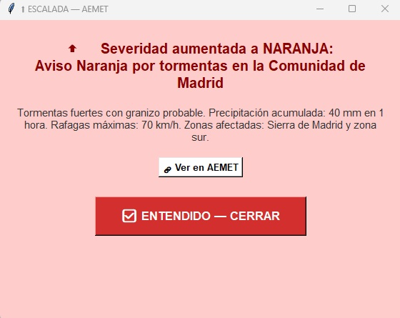

<div align="center">


<a href="https://www.linkedin.com/in/adri%C3%A1n-boza-su%C3%A1rez-51623a184/"></a>


<sub><a href="README.md">🇬🇧 English</a> · 🇪🇸 Español</sub>

</div>

Vengo de **operaciones de red**: turnos rotativos en un NOC 24x7, diagnosticando routers Cisco y Huawei de una WAN de ámbito nacional. Ahora construyo la capa de encima — **cloud, automatización y seguridad** — y me gusta entender cómo se rompe algo antes de fiarme de ello.

## ⚡ Ahora mismo

| 🎓 Máster en Ciberseguridad Cloud y DevSecOps | ☁️ Curso AWS Security (CTIC) | 🛠️ Homelab |
|---|---|---|
| Tajamar Tech, 700 h · oct 2026 – may 2027<br>Infraestructura en Azure, IaC, GitHub Actions | 140 h · nov – dic 2026<br>Camino a **AWS Security Specialty (SCS-C03)** | Un VPS con mi propio agente de automatización 24/7:<br>crons, servidores MCP, health checks |

## 🚀 Proyectos destacados

<table>
<tr>
<td width="50%" valign="top">

### ☸️ [Kubernetes que se cura solo](https://github.com/adrianboza2/proyecto-intermodular-asir)
<a href="https://github.com/adrianboza2/proyecto-intermodular-asir"></a>

Nginx con 2 réplicas, probes, Prometheus + Grafana y NetworkPolicies con **denegación por defecto**. Matas un pod y el tráfico no se corta.

`Kubernetes` `Docker` `Prometheus` `Grafana` `NetworkPolicy`

</td>
<td width="50%" valign="top">

### 🌩️ [Monitor de avisos meteorológicos](https://github.com/adrianboza2/script-aemet-python)
<a href="https://github.com/adrianboza2/script-aemet-python"></a>

Nació en mis prácticas por una **necesidad real de operaciones**: vigila los avisos oficiales de AEMET y avisa al equipo cuando uno aparece, sube de nivel o se resuelve.

`Python` `RSS` `SMTP` `cron` `Windows/Linux`

</td>
</tr>
</table>

<details>
<summary><b>🔒 Trabajo privado — te lo enseño encantado</b></summary>
<br>

| Proyecto | Qué hace |
|---|---|
| **jobscout** | Buscador de empleo local: recoge ofertas públicas, las deduplica en SQLite, puntúa cada una contra un perfil estructurado con un LLM y genera un dashboard HTML. Se ejecuta solo cada 72 h desde mi VPS. Hecho con ayuda de IA: el alcance, el diseño y la revisión son míos. |
| **Agente 24/7 en un VPS** | Servidor Ubuntu con tareas programadas (bandeja de enlaces, autoetiquetado, resumen semanal), health check cada 15 min, copias nocturnas con git y un servidor MCP publicado por Tailscale con OAuth de GitHub. |
| **Lab on-premises (máster)** | Routers Debian con DHCP en Kea, NAT con nftables y rutas estáticas entre varias subredes; dominio Windows Server 2025 con AD DS, OU, permisos NTFS y GPO; clientes Windows 11 unidos al dominio. |

</details>

## 🧰 Herramientas

<p align="center">
  
</p>

<sub>Además, en producción en el trabajo: routing y switching Cisco y Huawei (VLAN, STP, diagnóstico BGP), Cisco CUCM, hardening de equipos, despliegues de MDM/MFA.</sub>

## 🗺️ Ruta

```text
✅ CFGS ASIR (Administración de Sistemas en Red)   2024 – 2026
✅ Operaciones de red (NOC, 24x7)                  2026
🔄 Infraestructura Azure · AZ-900                   ahora
🔄 AWS Security · SCS-C03                           ahora
⏳ Terraform · GitHub Actions · DevSecOps           primavera 2027
```
