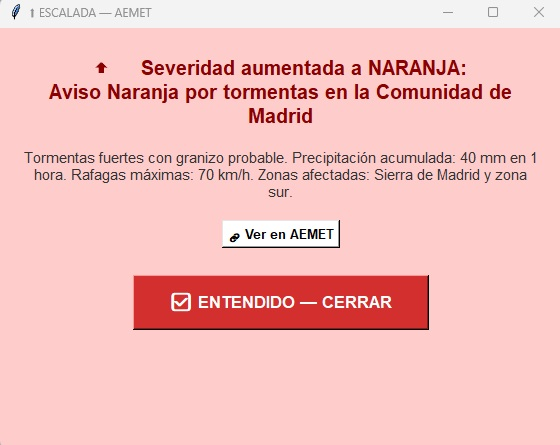

[LinkedIn](https://www.linkedin.com/in/adrian-boza-suarez/) · [Español](README.es.md)

I'm studying a Master's in Cloud Security & DevSecOps at Tajamar Tech and the AWS Security course at CTIC, after finishing a degree in Network & Systems Administration (ASIR). I learn by building things end to end and documenting how they work. These are the ones worth a look.

## Projects

<table>
<tr>
<td width="50%" valign="top">

**[Self-healing Kubernetes lab](https://github.com/adrianboza2/proyecto-intermodular-asir)** 
A web app on Minikube that keeps serving when a pod dies, monitored with Prometheus and Grafana and closed off with default-deny network policies. Final ASIR project, team of three; I built the cluster and deployments.

`kubernetes` `docker` `prometheus` `grafana`
</td>
<td width="50%" valign="top">

**[Weather warning monitor](https://github.com/adrianboza2/script-aemet-python)** 
Written during my internship, where it was used for real: it watches AEMET's official warnings and emails the team, with a desktop pop-up, when a warning appears, changes level or clears.

`python` `rss` `smtp` `cron`
</td>
</tr>
</table>

Not public yet, but I can show them:

- **jobscout** — collects job listings, stores them in SQLite and ranks them against my profile with an LLM. Runs by itself every three days on my server.
- **Home server** — an Ubuntu VPS with scheduled jobs, health checks, nightly backups to git and a small MCP server behind Tailscale.
- **On-prem lab** — Debian routers (Kea DHCP, nftables NAT) and a Windows Server 2025 Active Directory domain, built for the Master's.

## Studying now

| | |
|---|---|
| Azure infrastructure · AZ-900 | Master's, Oct 2026 – May 2027 |
| AWS Security · towards SCS-C03 | CTIC, Nov – Dec 2026 |
| Terraform, GitHub Actions, DevSecOps | Master's, spring 2027 |
